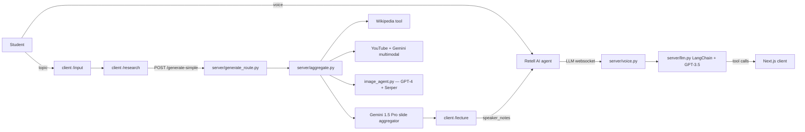
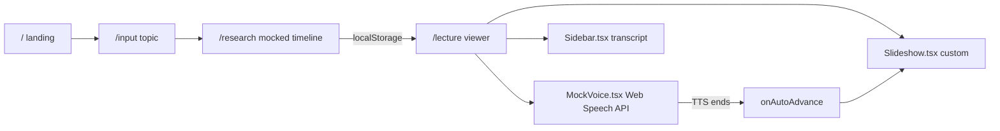

# AdaptEd

> Conversational learning. Lectures that talk back.
>
> An interactive tutoring platform that turns static teaching into a real-time
> conversation with an AI lecturer. Originally shipped at **LA Hacks 2024**,
> where it won the **Google First Place** sponsor track.

This repository is a **frontend-only showcase** of that hackathon build. The
original FastAPI backend is preserved verbatim under [`server/`](server) as a
historical artifact, but the running demo is mocked entirely in the browser.

- Demo reel — https://www.youtube.com/watch?v=8o1YJUFBcAw
- Original Devpost — https://devpost.com/software/teachme-3p7bw1
- Original team's repo — https://github.com/IdkwhatImD0ing/AdaptEd
- LA Hacks 2024 — https://la-hacks-2024.devpost.com/

## What it does

From the original Devpost: out of 16 million U.S. university students, half
are falling behind on static, one-sided lectures, and fewer than three
percent have access to a real tutor. AdaptEd flipped the paradigm — instead
of students adapting to the system, the AI lecturer adapts to students.

Three loops running in parallel made it work:

1. **Responsive AI** — voice conversation with end-of-turn detection, so the
   lecturer can be interrupted at any moment and pick up gracefully.
2. **Dynamic content** — slides and a whiteboard regenerate live based on
   verbal cues. Wikipedia, YouTube transcripts, and Serper image search feed
   the same Gemini context window.
3. **Emotion detection** — a side channel watches attention and confusion and
   nudges the lecturer to slow down or backtrack.

## The original architecture (what won at LA Hacks)



### What lived in [`server/`](server) (preserved, not invoked)

- [server/main.py](server/main.py) — FastAPI app, WebSocket manager, MongoDB
  connection.
- [server/aggregate.py](server/aggregate.py) — multi-source slide pipeline
  driven by Gemini 1.5 Pro with Wikipedia, YouTube audio+frames, and image
  search. Cycled a list of `GEMINI_API_KEYS` to dodge free-tier quotas.
- [server/voice.py](server/voice.py) — two websockets per call: Retell's
  Custom LLM URL plus a sidecar "data" socket the client used to push
  speaker notes and receive `next_slide` / `prev_slide` / `goto_slide` tool
  calls.
- [server/llm.py](server/llm.py) — LangChain `create_openai_tools_agent` over
  GPT-3.5-turbo-0613, three slide-control tools.
- [server/google_agent.py](server/google_agent.py) and
  [server/mermaid_agent.py](server/mermaid_agent.py) — Fetch.ai `uagents`
  experiments for the whiteboard.
- [intel_dev_cloud/fine_tune.ipynb](intel_dev_cloud/fine_tune.ipynb) —
  LoRA/PEFT fine-tuning attempt on Intel GPUs via `bigdl-llm[xpu]`.

## What this fork does — the mocked showcase flow



Every backend interaction is replaced with a deterministic browser-side mock:

- The **research page** plays a four-step animated timeline (Wikipedia →
  YouTube → image selection → slide drafting), then writes a canned lecture
  to `localStorage`.
- The **lecture viewer** reads that lecture (or falls back to
  [`mockLecture.ts`](client/app/lib/mockLecture.ts)) and renders the same
  template taxonomy as the original [`server/templates.py`](server/templates.py).
- The **voice loop** is replaced with `window.speechSynthesis`. The lecturer
  reads each slide's `speaker_notes`, auto-advances, and offers scripted
  prompt chips (`"Explain that again"`, `"Skip ahead"`) to demo the
  conversational interrupt feature.

## File map — `client/`

```
client/
  app/
    page.tsx              Landing — hero, YouTube embed, features, origin
    layout.tsx            Fonts (Fraunces / Instrument Sans / JetBrains Mono)
    globals.css           CSS variables, theme tokens, utility classes
    input/page.tsx        Topic entry — pre-filled with "Red-Black Trees"
    research/page.tsx     Mocked research timeline
    lecture/page.tsx      Slideshow + voice + transcript layout
    components/
      NavBar.tsx          Top navigation
      Slideshow.tsx       Custom slide renderer for templates 0/1/2/4/8/9/10/11
      MockVoice.tsx       speechSynthesis-driven mock voice + scripted chips
      Sidebar.tsx         Live transcript pane
      YouTubeEmbed.tsx    Lazy, privacy-enhanced demo embed
      Typewriter.tsx      Tiny TS rewrite of react-type-animation
    lib/
      types.ts            Lecture / Slide / TranscriptEntry types
      mockLecture.ts      The canned Red-Black Trees lecture
      mockTranscript.ts   Scripted prompts for the conversational interrupt
  tailwind.config.ts      Brand tokens, font variables, custom keyframes
  next.config.mjs         Allow remote images for slide assets
```

## Running the showcase

```bash
cd client
npm install
npm run dev
```

Open http://localhost:3000.

The build is also exercised by `npm run build` — the showcase ships as four
fully static routes (`/`, `/input`, `/research`, `/lecture`).

There is no `.env` to fill in. The Web Speech API is built into modern
browsers (best results on Chromium and Safari).

## What changed from the original repo

| | LA Hacks 2024 | This showcase |
| --- | --- | --- |
| Frontend framework | Next.js 14.2 + React 18 | Next.js 15 + React 19 |
| Slideshow | Spectacle 10 + BroadcastChannel sync | Custom `<Slideshow />` component |
| Voice | Retell AI + GPT-3.5 + ngrok | `window.speechSynthesis` mock |
| Animation | `react-reveal` (React 16 era) | `motion` (Framer Motion successor) |
| Auth | Auth0 (never wired) | Removed |
| Typography | Inter | Fraunces · Instrument Sans · JetBrains Mono |
| Styling | SCSS (`global.sass`) + Tailwind | Tailwind + CSS variables |
| Build deps | 22 prod / 12 dev | 6 prod / 9 dev |

## Credits

AdaptEd was built by the original 6-person team at LA Hacks 2024 — see the
[Devpost writeup](https://devpost.com/software/teachme-3p7bw1) and
[`IdkwhatImD0ing/AdaptEd`](https://github.com/IdkwhatImD0ing/AdaptEd) for the
full crew. This fork's frontend showcase is a homage, not a replacement.

## License

[MIT](LICENSE), inherited from the original repo.
